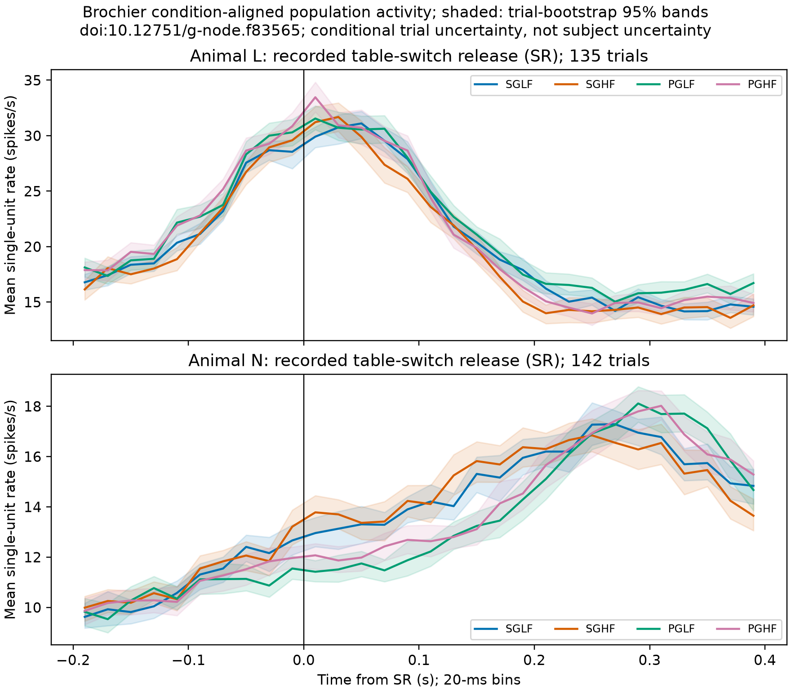
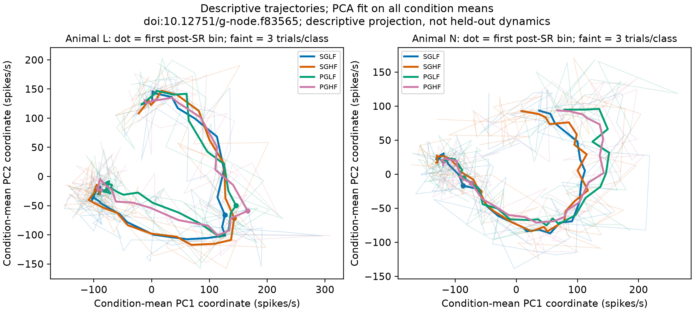
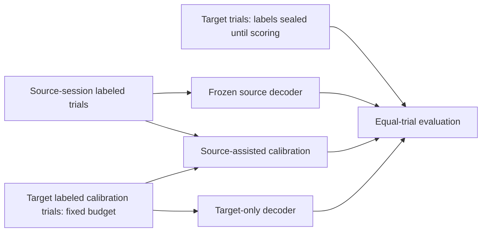
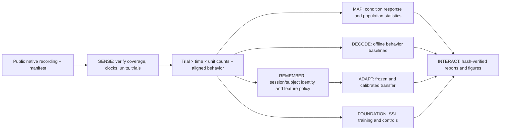

# CEREBRO: adaptive neural intelligence research foundation

**Integrated technical report, Mission 020.** Observations below come from authentic public neural recordings and the exact committed experiment artifacts cited in each section. CEREBRO's thesis is that neural population representations could support decoding, session transfer and efficient calibration; broad transfer remains **unproven**. This report separates implemented software, executed experiments and supported biological conclusions. The original [33-requirement audit](full_scope_audit.json) is retained; the [Mission 020 traceability matrix](mission_020_traceability.md) evaluates the same scope.

## 1. Motivation and scientific questions

Can a neural population representation capture task-related activity, predict behavior, survive recording changes, and use fewer target labels? The platform tests these questions with explicit session/subject partitions and controls. A working encoder, decoder, or pretraining loss is a software fact, not evidence that a representation transfers. Negative comparisons remain part of the research record.

## 2. Related work

The [Neural Latents Benchmark](https://neurallatents.github.io/datasets.html) standardizes public population recordings and evaluation contexts. [Churchland et al.](https://www.nature.com/articles/nature11129) motivated analysis of motor-cortex population trajectories; a plotted projection alone does not establish their dynamical account. [Cohen and Kohn](https://www.nature.com/articles/nn.2842) emphasize dependence of neural correlation estimates on analysis choices and recording properties. [Brochier et al.](https://pmc.ncbi.nlm.nih.gov/articles/PMC5892370/) describe the instructed delayed reach-to-grasp recordings analyzed here. These papers motivate questions and terminology; CEREBRO results are confined to the datasets and controls below.

## 3. Data and provenance

| Corpus | Recorded population and target | CEREBRO use | Primary provenance |
|---|---|---|---|
| [NLB MC_Maze Small](https://doi.org/10.48324/dandi.000140/0.220113.0408) | Intracortical units and hand velocity | SENSE, MAP, offline decoding, event audit | [asset and methods](../datasets/mc_maze_small.md), [SENSE report](../../reports/sense_01.json) |
| [NLB MC_Maze](https://neurallatents.github.io/datasets.html) | Larger motor population | Native metadata and event/repetition feasibility audit; decoder benchmarks in this report use **Small**, not this recording | [native audit](../../reports/mc_maze_native_audit.json), [event feasibility](../../reports/mc_maze_event_feasibility.json) |
| [LINK DANDI 001201](https://dandiarchive.org/dandiset/001201/0.251023.2336) | One monkey, multiple sessions, contact-resolved threshold events and finger flexion | Longitudinal transfer and SSL controls | [Mission 016](../../reports/mission_016.md), [protocol](mission_016_protocol.json) |
| [FALCON](../datasets/falcon_multisubject.md) | Neural activity and author-preprocessed EMG | Exploratory subject-aware evaluation | [limitations](../release/acceptance_matrix.md) |
| [Brochier reach-to-grasp](https://doi.org/10.12751/g-node.f83565) | Two animals, one session each; sorted spikes, sampled neural stream, event and task labels | Frozen four-class cross-animal case study and this population analysis | [native asset hashes](../datasets/mission_019_brochier_assets.json), [native audit](../datasets/mission_019_brochier.md) |

The Brochier native sampled streams establish actual coverage; spike extrema alone would not. Original files and processed tensors remain Git-ignored. Perich remains audit-only because authentic neural observation intervals are not established. FALCON EMG was processed upstream of CEREBRO splits; raw-target recovery and train-only target transformation are unverified. Brochier physical sensor calibration is insufficient for strict continuous-target cross-animal regression. See [dataset eligibility inventory](../datasets/mission_016_eligibility.md) for individual eligibility.

## 4. Neural signal processing

SENSE retains source trial IDs, unit IDs, physical clocks, event ticks, sampling coverage and masks. A trial/bin/unit spike-count tensor contains discrete counts; rates in spikes/s divide by bin duration. The MC_Maze bin-width experiment used identical source trials and found 5/20/50-ms count sparsities of 98.3982/93.9098/86.3857% over matched 283 s and 129,663 spikes ([report](../../reports/signal_characterization.md)). Brochier Mission 020 used native 30 kHz ticks, 600-tick half-open bins, and no smoothing or interpolation. Its tensors are L `135×30×93` and N `142×30×156` ([machine report](../../reports/mission_020_brochier_population.json)).

## 5. Classical population analysis

PCA and factor analysis baselines, train-only dimension selection and population geometry are implemented ([population results](../../reports/classical_05.json); [test](../../tests/test_population.py)). MC_Maze Small go-cue alignment contains 75×70×142 observations, with 21 conditions repeated three times and six repeated twice. A +200–600-ms population rate of 4.319249 spikes/s exceeded the pre-event 3.089202 by 1.230047 spikes/s within that recording, but replication was inadequate for reliable residual correlation ([Mission 004](../../reports/event_04.md)).

Brochier provides four conditions with 30–41 correct repetitions per animal. After subtracting each condition-and-event-time mean, the median absolute post-trial residual unit-pair correlations were 0.070 (L) and 0.068 (N); residual population-mean variance ratios relative to diagonal-only references were 1.449 and 2.077. The ratios changed from 1.923 to 1.060 across L's chronological halves and 2.232 to 1.586 across N's. Single-condition residual rank ceilings are 29–40 and 34–35, below 93 and 156 units, so **high-dimensional residual covariance is not established**. Full definitions, shuffle references and uncertainty caveats are in the [Mission 020 scientific report](../../reports/mission_020_brochier_population.md).

## 6. Neural dynamics

Condition-mean participation ratios in Brochier are 5.239 (L) and 3.163 (N) across 120 condition/time vectors. The first two descriptive PCA components account for 0.315/0.267 (L) and 0.532/0.158 (N) of condition-mean variance. These are descriptive trajectories, not validated latent physiological dynamics. The existing MC_Maze trial-local, teacher-forced one-bin AR(1) latent forecast has MSE 1.18176068 latent² versus persistence 2.12926664 and a within-trial permuted-time control 1.22131164 ([machine artifact](../../reports/dynamics_10.json)); proximity to that control limits mechanistic interpretation.

## 7. Classical movement decoding

On the fixed MC_Maze Small split, full-trial offline hand-velocity MSEs include mean predictor 0.03832482, ridge 0.03542144 and Kalman 0.03131415 in the report's velocity-squared units ([benchmark](../../reports/benchmarks.md)). Prediction is contemporaneous/offline under the documented preprocessing; no prospective causal or online BCI behavior is demonstrated. Model comparisons should not be pooled across different targets, windows or datasets.

## 8. Modern sequence benchmarks

The platform implements and tests MLP, GRU/LSTM, causal CNN, Transformer and state-space variants ([source](../../src/cerebro/sequence_models.py), [tests](../../tests/test_sequence_benchmark.py)). A fixed three-seed MC_Maze comparison reports temporal CNN mean MSE 0.03105193 in the same benchmark. Different model sizes and a limited compute sweep prevent broad architecture rankings. Available MPS backend checks are software checks, not demonstrated GPU research equivalence or CUDA performance.

## 9. Cross-session adaptation

The prespecified LINK study used three held-out dates from **one** monkey and 15 labeled chronological calibration trials for the primary contrast. Source-assisted minus target-only ridge equal-trial MSE was positive on all dates (+0.00055375, +0.00067157, +0.00061931 flexion²; equal-date +0.00061488), so the specified source assistance did **not** improve that comparison ([Mission 016](../../reports/mission_016.md)). Source-frozen and source-mean controls also outperformed both 15-label calibration methods on these dates. The [adaptation diagnostics](../../reports/mission_017_adaptation.md) examine sample size, distribution and scaling; they do not causally identify neural drift. Contact coordinates establish feature ordering, not neuron identity.

## 10. Cross-animal transfer

A frozen Brochier protocol classified **four grip-by-load task conditions**, not continuous movement or EMG. Source-assisted minus target-only balanced accuracy was +0.0126 for L→N and +0.0021 for N→L; target-trial bootstrap intervals included zero in both directions ([Mission 019](../../reports/mission_019_brochier_transfer.md)). It was a two-animal, one-session-each case study with anonymous features, not independent evidence of general subject invariance. Uncalibrated physical sensor correspondence and subject/session confounding block stronger continuous-target claims.

## 11. Self-supervised representation learning

Masked and predictive objectives, checkpoint restoration, and controlled transfer software are present ([representation report](../../reports/representation_09.md), [tests](../../tests/test_representation_transfer.py)). Frozen pretrained and random controls were near-identical in the reported three-session LINK study; a 98.0% source-date identity probe shows retained session information. No general-purpose neural foundation-model benefit or cross-subject SSL transfer is demonstrated.

## 12. Statistical methods and controls

Splits and transformations are recorded before held-out evaluation where possible; scaler fitting is train-only in CEREBRO-controlled pipelines. Whole trials, dates or animals are the independent units appropriate to each question. The Brochier bootstrap resamples whole trials within condition, while its shuffles independently permute units' trials inside each condition. Trial bootstrap bands are conditional on a single session; nonlinear-statistic bootstrap percentile ranges show bias and are **not calibrated cross-subject confidence intervals**. Pairwise neural correlations and time bins are dependent, and covariance does not imply causal connectivity. Model-selection history and upstream FALCON target processing constrain confirmatory claims. See [release acceptance evidence](../release/acceptance_matrix.md).

## 13. Negative and inconclusive findings

The LINK 15-label primary contrast was negative for source assistance; Brochier four-class source assistance was inconclusive at trial-level precision; self-supervised frozen controls did not show a reproducible transfer advantage; full Brochier residual covariance is rank limited. These are scientific outcomes or limitations, not software defects. No result supports successful online control, broadly stable manifolds, continuous cross-animal movement decoding, or subject-invariant foundation representations.

## 14. Limits and future work

Key external gates are split-safe continuous targets in multiple animals, independent biological replication across subjects/sessions, documented coverage for Perich, and new untouched cohorts for model selection. For population variability, a larger number of matched trials per condition and repeated sessions could improve residual covariance precision and allow stability checks. A prospective continuous-target cross-animal protocol must establish behavioral sensor calibration before outcome inspection. Human researchers retain ownership of model choice, interpretation and release claims.

## 15. Capabilities, workflow and reproducibility

The six scientific capabilities are **SENSE** (acquisition and valid counts), **MAP** (population geometry and event statistics), **DECODE** (offline behavior prediction), **REMEMBER** (session/subject indexing and representation comparison), **ADAPT** (calibration and transfer), and **FOUNDATION** (self-supervised objectives and controls). **INTERACT** is the local research explorer and presentation layer, not evidence of closed-loop BCI. [Architecture and data flow](../architecture.md) and the [researcher walkthrough](workflows.md) explain module boundaries.

Install with the [README instructions](../../README.md) in Conda `cerebro`. Acquire exact sources using the [dataset eligibility inventory](../datasets/mission_016_eligibility.md). Run `conda run -n cerebro python -m pytest -q` for public software tests, then `conda run -n cerebro python -m tools.brochier_population` after placing checksum-pinned Brochier assets in `data/raw/brochier/`. The command verifies hashes and produces the [machine report](../../reports/mission_020_brochier_population.json), three figure pairs and an ignored tensor file. Reproduce other studies with [documented workflow commands](workflows.md) and their frozen configs. Never treat a synthetic fixture as biological evidence.

**Glossary.** A *sorted unit* is a source-assigned putative neuron's spike train; an *electrode/contact* is a physical recording site and does not imply the same neuron across days. A *spike-count bin* is a half-open time interval's integer count; a *firing rate* here is count divided by duration. A *signal-like correlation* relates unit means across conditions/times; a *residual correlation* relates deviations after matching expected condition/time activity. A *Fano factor* is across-trial count variance divided by mean for a fixed window. A *participation ratio* summarizes eigenvalue concentration of a specified covariance, not an intrinsic neuron count. A *calibration budget* counts target trials whose labels a method may access. *Source-assisted* and *target-only* compare methods at the same target-label budget. A *biological replication unit* is a distinct animal for cross-animal generalization, not another trial from one animal.

An *observation interval* is time with recorded neural samples; spikes at two endpoints do not certify intervening coverage. An *event* is a timestamped source task marker; a *condition* is a recorded task-label category; a *trial* is the source-defined repetition with boundaries. A *residual* is observation minus its prespecified condition/time expectation; *covariance* measures joint variation and does not identify synapses or causality. A *decoder* maps neural features to recorded targets under a specified timing convention. *Leakage* is evaluation information entering fitting, tuning or preprocessing. An *estimand* is the exact population or sample contrast a study intends to measure. A *latent representation* is an inferred low-dimensional feature, not automatically a physiological state. A *foundation-model claim* requires broad, independently validated transfer beyond an implemented pretraining objective. A *bootstrap percentile range* is a resampled estimate distribution and need not have calibrated coverage, especially for biased nonlinear statistics.
