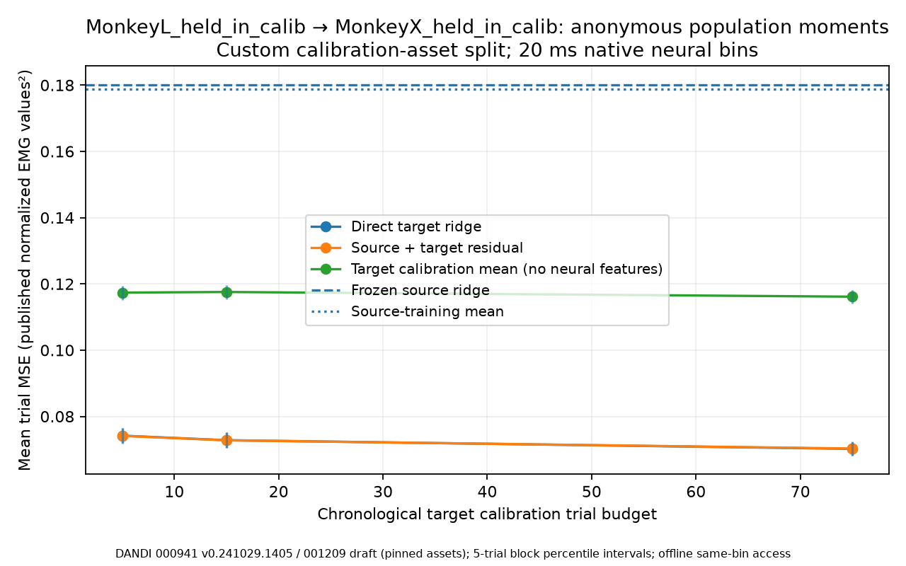

# Cross-subject anonymous-population baseline

MonkeyL_held_in_calib → MonkeyX_held_in_calib; authentic public FALCON calibration recordings. This is a custom chronological experiment, not an official FALCON score.

Observed recordings contain 64 source and 64 target units. Neural unit rows have no assumed cross-subject identity. Seven permutation-invariant count moments are deliberately lossy features; exact source muscle names define shared output coordinates only.

Common muscle coordinates: APL, BCPs, DLTa, DLTp, ECRB, ECU, EDC, FCR, FCU, FDI, FDPr, FDPu, Hypoth, PECmaj, TCPlat, Thenar.

Source first300 original trial rows fit the final model, with first225 used for internal fitting and the rest for ridge selection. Source-selected alpha: 100.0. Target first75 original trial rows are the calibration pool; remaining eligible trials are evaluation only. Empty trials never shift these boundaries.

Native source keep masks, per-unit observation coverage, finite targets, original sample indices, and exact timestamps are preserved. Eligible source evaluation trials: 112; target evaluation trials: 354.

| Target control | Label trials | Mean trial MSE (normalized EMG²) |
|---|---:|---:|
| source_frozen | 0 | 0.18015094 |
| source_mean | 0 | 0.17882617 |
| target_calibration_mean | 5 | 0.11736611 |
| target_direct | 5 | 0.07418314 |
| source_plus_residual | 5 | 0.07411904 |
| target_calibration_mean | 15 | 0.11755682 |
| target_direct | 15 | 0.07281436 |
| source_plus_residual | 15 | 0.07277965 |
| target_calibration_mean | 75 | 0.11613538 |
| target_direct | 75 | 0.07020837 |
| source_plus_residual | 75 | 0.07029598 |

Frozen source ridge minus source-training mean target MSE: 0.00132477 normalized EMG². Negative values favor ridge. This measurement does not establish universal transfer or neural correspondence.

Target calibration means use the same labeled trial pool without neural features, separating EMG baseline adjustment from measured neural-feature benefit.

At the largest label budget (75), direct target ridge minus target calibration mean MSE is -0.04592702; source-plus-residual minus direct ridge is 0.00008761 normalized EMG². Negative contrasts favor the first method. Paired block intervals for both contrasts are recorded in JSON; these measured differences do not imply generalizable transfer superiority.

Uncertainty uses paired trial losses and both independent-trial and moving-block resampling at configured block lengths; the figure shows the largest configured block. These descriptive intervals do not certify independence or significance.

## Provenance and limitations

- DANDI 000941, version 0.241029.1405, asset `61dbe78b-58da-4089-b308-96378c5a95b9`, SHA256 `96e7f078c6acb89b802b6241a36b9c9e2d04df82c180a63354fd3f7e74357254`.
- DANDI 001209, version draft, asset `4c3140ea-abe6-4c3c-a2ea-1025e5bef288`, SHA256 `df056afae5eafb00519ed6231d62e4e7bbce331490ab6fe31f215c0667e5bd7f`.

- Seven anonymous neural moments are deliberately lossy population summaries, not unit-identity alignment or learned foundation representations
- Sorted units have no cross-subject identity; unit row positions are never used as shared feature coordinates
- Exact muscle names establish output coordinates only; object conditions, task distributions, and physiological scaling need not match across subjects
- Published author quantile-normalized EMG is used in native values; NWB mV metadata does not certify calibrated absolute amplitude
- Author full-recording EMG filters and quantile normalization precede these trial splits; original preprocessing cannot be certified leakage-free
- Native target at left bin edge is paired with neural counts through right edge; this is offline prediction with current-bin access, not a causal real-time controller
- Only one public calibration recording per subject; subject, session, and date effects are confounded
- Source B is a mutable draft release pinned by asset UUID and verified checksum
- Moving-block intervals are descriptive sensitivity analyses; independence and block-length adequacy are not established

Published native targets are author quantile-normalized EMG. Full-recording author filters/scaling predate CEREBRO splits, so original preprocessing is not certified leakage-free. The stored mV label does not establish absolute EMG amplitude.

Checkpoints and prediction/mask archives remain in Git-ignored `data/processed/cross_subject_12/`. Every checkpoint was restored and predictions verified; JSON binds code/environment, splits, checkpoints, and array hashes.

Reproduce: `python -m cerebro.cross_subject --config configs/cross_subject_12.json --output data/processed/cross_subject_12`.

