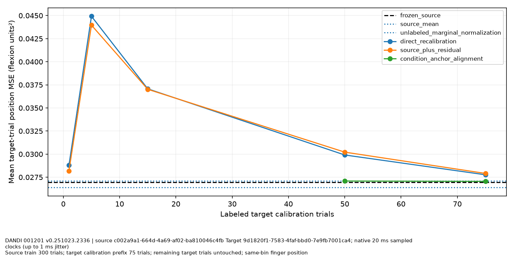
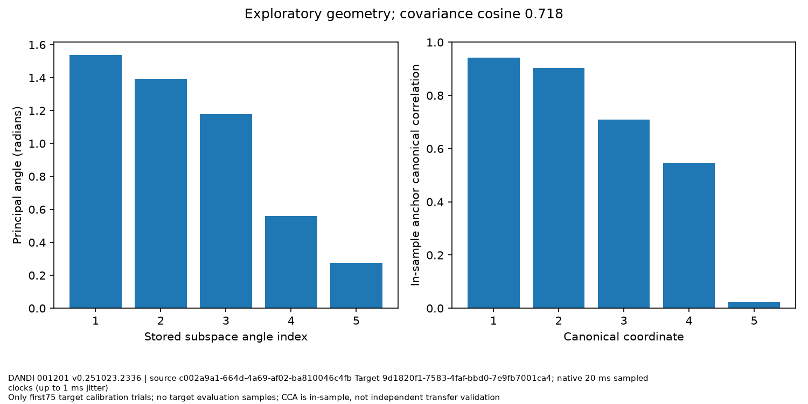

# Longitudinal experiment 08

DANDI 001201 v0.251023.2336 | source c002a9a1-664d-4a69-af02-ba810046c4fb
Target 9d1820f1-7583-4faf-bbd0-7e9fb7001ca4; native 20 ms sampled clocks (up to 1 ms jitter)

Source train 300 trials; target calibration prefix 75 trials; remaining target trials untouched; same-bin finger position

Source-only tuning; chronological target75 calibration pool versus300 untouched evaluation trials. All methods use same target evaluation. Marginal normalization and target PCA receive75 unlabeled calibration trials; supervised methods receive only named prefix trial labels. Anchor methods also receive calibration commanded-target metadata. No target evaluation normalization or selection.

| Method | MSE (flexion units²) | Paired change from frozen | Moving-block sensitivity interval |
|---|---:|---:|---|
| condition_anchor_alignment_50 | 0.0270873 | 0.000121165 | [-0.000693684176276276, 0.0008346289908409363] |
| condition_anchor_alignment_75 | 0.0270475 | 8.13372e-05 | [-0.0007144822972546382, 0.0007699866092689209] |
| direct_recalibration_1 | 0.0287877 | 0.00182154 | [0.0008100763608741816, 0.0028459471910866393] |
| direct_recalibration_15 | 0.037069 | 0.0101029 | [0.007972619980141675, 0.012173226593229843] |
| direct_recalibration_5 | 0.0449233 | 0.0179572 | [0.014987152598843758, 0.020484064031996436] |
| direct_recalibration_50 | 0.0299074 | 0.00294122 | [0.0014185577328118901, 0.004213507674106902] |
| direct_recalibration_75 | 0.0277636 | 0.000797425 | [-0.00030607532576265833, 0.0017147069001557692] |
| frozen_source | 0.0269661 | 0 | [0.0, 0.0] |
| source_mean | 0.0270838 | 0.000117653 | [-0.0006961318399130433, 0.0008301490275405655] |
| source_plus_residual_1 | 0.0281871 | 0.00122094 | [0.00042257047059210705, 0.0019473624667202675] |
| source_plus_residual_15 | 0.0370168 | 0.0100506 | [0.008075431522770382, 0.012026944332379755] |
| source_plus_residual_5 | 0.0439629 | 0.0169968 | [0.014226860444167018, 0.019399921781185173] |
| source_plus_residual_50 | 0.0302147 | 0.00324853 | [0.0016963275269542132, 0.004541061899755618] |
| source_plus_residual_75 | 0.0279093 | 0.000943168 | [-0.00016679584211150996, 0.0018698207771688535] |
| unlabeled_marginal_normalization | 0.0263827 | -0.000583451 | [-0.0014547512403237483, 9.90179339635489e-05] |

Covariance cosine: 0.718375. In-sample small-anchor CCA overfits; not independent transfer validation or neuron correspondence. Two sessions from one Monkey N do not establish subject generalization or a foundation model. Moving-block intervals are sensitivity analyses, not validated population uncertainty.

Attribution: Temmar, Hisham; Gill, Nina; Wang, Yixuan; and LINK contributors, CC-BY-4.0; [pinned LINK release](https://dandiarchive.org/dandiset/001201/0.251023.2336).

Limitations: Two sessions of one monkey are not independent subject replicates; Channel matching does not establish stable neurons; Threshold-crossing count interpretation follows native description and integer values despite NWB volts label; No explicit quality mask; finite samples are not proof of signal quality; Native20ms clocks jitter by up to1ms; no interpolation or recomputed firing rates; Unlabeled target access differs across methods and is explicitly disclosed; Anchor alignment uses noisy commanded-target trial means, not event-time matched repeated neural responses; Moving 5-trial block interval is sensitivity analysis, not validated population uncertainty; Hyperparameters for adaptation inherited from source-only selection; No actual biological closed-loop or multisubject inference

