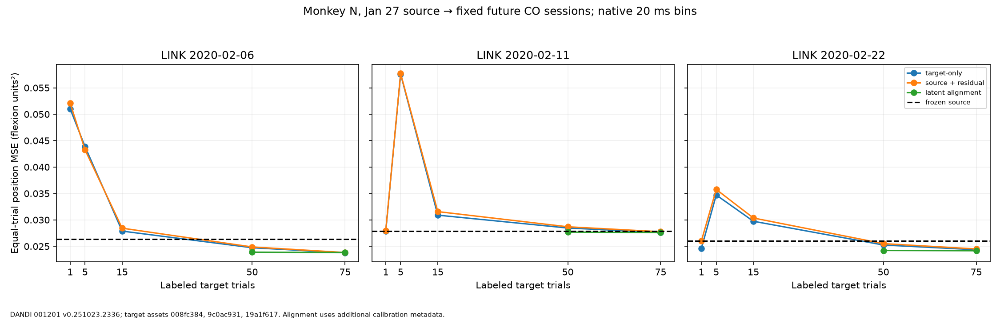
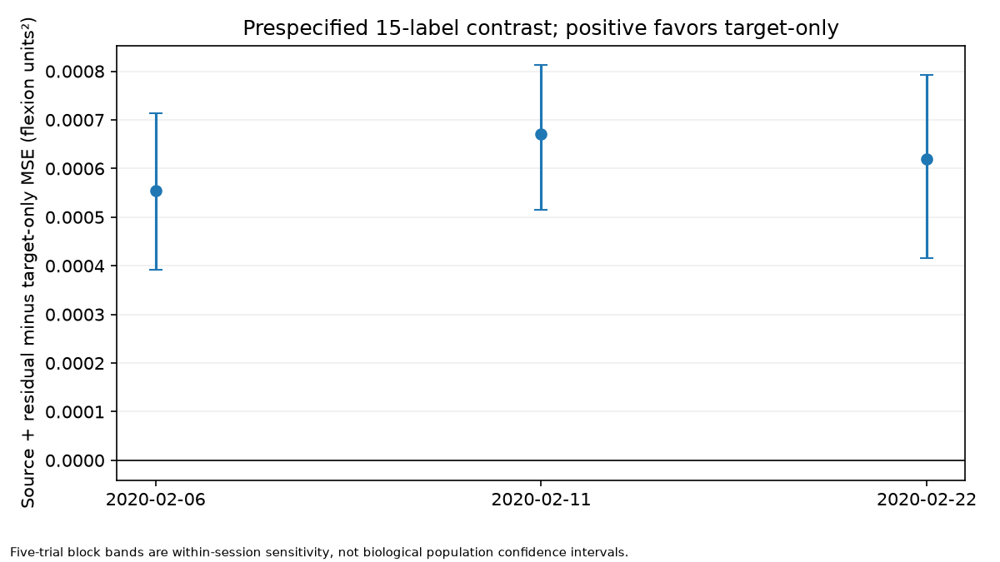
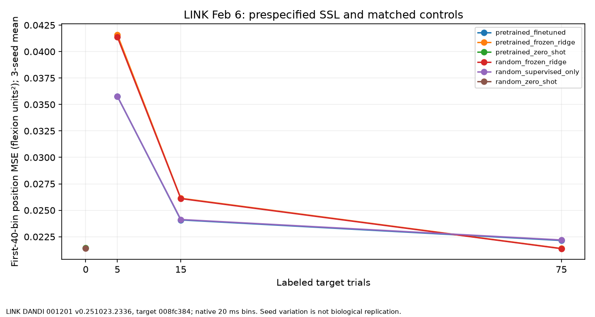

# Mission 016: independent-date LINK transfer

Observed results from authentic [LINK DANDI 001201 v0.251023.2336](https://dandiarchive.org/dandiset/001201/0.251023.2336) recordings, CC-BY-4.0 (Temmar and colleagues). The [frozen protocol](../docs/research/mission_016_protocol.json) was committed before these model runs. Source Jan 27, 2020; target Feb 6, 11 and 22, 2020. The three targets were selected by date/metadata, not scores. Native sampled clocks and trial identities are preserved.

## Primary 15-label comparison

Each target has 75 chronological calibration trials and 300 later evaluation trials. MSE is averaged within trial over two finger-position coordinates, then equally across trials. The contrast is source-assisted residual ridge minus target-only ridge; negative favors source assistance.

| Target date | Target-only MSE (flexion²) | Source + residual MSE (flexion²) | Difference (flexion²) | Relative difference |
|---|---:|---:|---:|---:|
| 20200206 | 0.02787549 | 0.02842924 | +0.00055375 | +1.99% |
| 20200211 | 0.03089452 | 0.03156608 | +0.00067157 | +2.17% |
| 20200222 | 0.02973836 | 0.03035767 | +0.00061931 | +2.08% |

Equal-date mean difference: **+0.00061488 flexion²**; all-three-date benefit criterion: **not met**. This is a negative transfer finding for the fixed comparison, not a software failure. Source mean, frozen decoder, complete budget curves and available latent alignment are preserved in the machine report and figure. Alignment uses additional commanded-target metadata and all 75 unlabeled calibration trials; it is secondary, not an equal-input head-to-head claim.

## Within-session and frozen cross-session evidence

The Jan 27 source decoder's within-session reserved 75-trial MSE is 0.03150958 flexion² (previously inspected; descriptive only). Frozen source transfer on each new target is compared with the source-position mean:

| Target date | Frozen-source MSE (flexion²) | Source-mean MSE (flexion²) |
|---|---:|---:|
| 20200206 | 0.02635430 | 0.02387138 |
| 20200211 | 0.02786564 | 0.02765507 |
| 20200222 | 0.02601508 | 0.02420724 |

Frozen-source and source-mean controls both outperform the 15-label target-only and source-assisted ridge methods on all three dates; the primary contrast does not establish target-only recalibration as the best overall method. The full 1/5/15/50/75-label target-only and source-assisted curves are plotted without choosing a favorable budget. With three dates from one monkey, date-level effects are descriptive, not independent-subject inference.

## Self-supervised representation transfer

The earliest unseen target has the prespecified three-seed controls below; differences are pretrained minus matched random/supervised MSE, so negative favors pretraining.

| Comparison | Target labels | Pretrained MSE (flexion²) | Control MSE (flexion²) | Difference (flexion²) |
|---|---:|---:|---:|---:|
| pretrained_zero_shot vs random_zero_shot | 0 | 0.02142979 | 0.02141179 | +0.00001801 |
| pretrained_frozen_ridge vs random_frozen_ridge | 15 | 0.02613769 | 0.02610630 | +0.00003139 |
| pretrained_finetuned vs random_supervised_only | 15 | 0.02408936 | 0.02413065 | -0.00004129 |

All controls, budgets and seed ranges are in the machine report. These small mixed effects do not establish transferable or foundation-model advantage. Its first-40-bin MSE must not be pooled with full-trial ridge MSE.

## Cross-subject status and limits

Cross-subject validation was not run because no audited public candidate meets both neural-coverage and original-target preprocessing gates.

All recordings are from one monkey. Contacts are mapped by coordinates, not neuron identity. Run ID 3 in the source and 2 in targets is within-day order per the authors, but date and run effects cannot be causally separated. The native threshold-crossing series has a contradictory volts unit label; the count interpretation follows source description. Native flexion targets and upstream sensor calibration are retained. Five-trial block bands are within-session sensitivity, not population confidence intervals. No foundation-model, online-control or cross-subject success follows.

Reproduce with the acquisition manifests, then run the four experiment commands in [the workflow guide](../docs/research/workflows.md). Run `python tools/report_mission_016.py` to verify stored arrays and regenerate the reports/figures.

