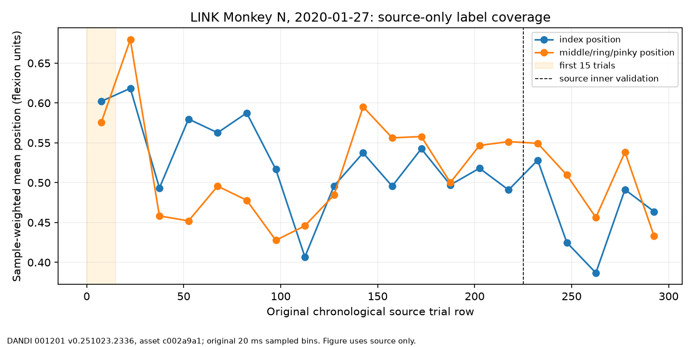

# Mission 017: low-budget LINK adaptation diagnosis

This is an **observational diagnosis**, not a new method-selection experiment. [Machine-readable values](mission_017_adaptation.json) come from the checksum-pinned LINK Monkey N Jan 27 source and the already inspected February 6/11/22 target recordings. The [generator](../tools/diagnose_mission_017.py) verifies the historical split, all four raw assets, and stored prediction arrays. It fits no models and changes no Mission 016 score.

The existing [protocol](../docs/research/mission_016_protocol.json) uses the first 15 chronological target trials as labeled calibration for a 96-contact, 20 ms-count ridge decoder. Those trials contain 939–1,182 bins, but only **15 trial units**; adjacent bins share movement and neural state. They cannot be treated as roughly 1,000 independent calibrations. The first 15 Jan 27 *source-development* trials contain 1,368 bins and only 8 commanded targets, while the following 60 contain 4,477 bins and 14 targets. Their sample-weighted position means differ: `[0.602, 0.575]` versus `[0.563, 0.517]` flexion. [Source-only figure](figures/mission_017_source_coverage.png) shows chronological variation before any new target date is considered.

Retrospective target-date inspection, **never used to choose a new parameter**, shows a consistent index-position coverage mismatch:

| Previously inspected date | First-15 calibration index mean | Later-300 evaluation index mean | Direct-15 prediction index mean | Frozen prediction index mean | Fraction of zero contact-bins, calibration → evaluation |
|---|---:|---:|---:|---:|---:|
| Feb 6 | 0.588 | 0.496 | 0.583 | 0.536 | 0.893 → 0.911 |
| Feb 11 | 0.585 | 0.509 | 0.591 | 0.506 | 0.906 → 0.916 |
| Feb 22 | 0.597 | 0.496 | 0.600 | 0.519 | 0.905 → 0.916 |

All means are sample-weighted native flexion values; Mission 016's primary metric remains equal-*trial* MSE. The direct-15 predictions retain a high index mean close to the early calibration labels, whereas the later evaluation labels are lower. This is **consistent with** nonrepresentative chronological calibration and prediction bias. It is not a causal decomposition of the MSE. Across the three dates, saved direct-15 index prediction standard deviations are 0.050–0.056 flexion; source-plus-residual values are 0.062–0.069. Their difference alone cannot identify a variance mechanism.

The source-only alpha search selected 1,000, the edge of `[1, 10, 100, 1000]`, but selection losses are nearly flat: 0.033359 at alpha 1 versus 0.033330 flexion² at alpha 1,000. Thus neither under- nor over-regularization is established. Both calibration methods use the source-fitted scaler and alpha. Algebraically, source-plus-residual ridge penalizes the correction around frozen source coefficients, whereas direct ridge penalizes coefficients around zero. The [observed 15-label disadvantage](mission_016.md) can reflect this prior interacting with sparse features, limited independent trials and label shift; it does **not** demonstrate unstable neurons or representations. Contact coordinates are not neuron identities.

No new hyperparameter or architecture is proposed from the three previously inspected dates. A mechanism test would use isolated source-development pseudo-target splits and then a prospectively reserved new session cohort. Until then, the precise contribution of calibration sampling, scaling, regularization and neural drift is **unresolved**.

Source Jan 27 uses a different within-day run ID from the three target dates; session, date and run effects remain confounded. No source-to-target neuron identity or causal drift measurement is available.

