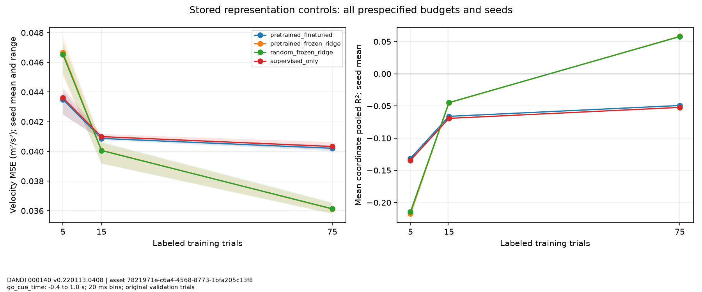

# Representation experiment 07

DANDI 000140 v0.220113.0408 | asset 7821971e-c6a4-4568-8773-1bfa205c13f8

go_cue_time: -0.4 to 1.0 s; 20 ms bins; original validation trials

Fixed epochs with no validation selection. SSL and feature scaling use every source training trial only; probe/supervised velocity labels use nested trial budgets. Target scaling uses each labeled budget only. Evaluation uses original source validation trials.

Seeds: [0, 1, 2]. Ranges reflect optimization seeds, not trial uncertainty. Negative R² and nonmonotonic budgets remain visible; no best test result selected. This small single-session experiment does not establish foundation-model performance.

| Control | Labeled trials | Mean MSE (m²/s²) | Mean coordinate R² |
|---|---:|---:|---:|
| pretrained_finetuned | 5 | 0.0434975 | -0.131403 |
| pretrained_finetuned | 15 | 0.0408748 | -0.066134 |
| pretrained_finetuned | 75 | 0.0402152 | -0.0492435 |
| pretrained_frozen_ridge | 5 | 0.046657 | -0.217659 |
| pretrained_frozen_ridge | 15 | 0.0400755 | -0.0450909 |
| pretrained_frozen_ridge | 75 | 0.0361193 | 0.0581659 |
| random_frozen_ridge | 5 | 0.0465315 | -0.214462 |
| random_frozen_ridge | 15 | 0.0400613 | -0.0447156 |
| random_frozen_ridge | 75 | 0.0361348 | 0.0577656 |
| supervised_only | 5 | 0.0436123 | -0.134331 |
| supervised_only | 15 | 0.0409974 | -0.0692449 |
| supervised_only | 75 | 0.0403327 | -0.0522359 |

Dataset: Churchland, Mark; Kaufman, Matthew. MC_Maze, CC-BY-4.0. [Pinned release](https://dandiarchive.org/dandiset/000140/0.220113.0408).

Limitations: Within-session representation experiment only; no foundation-model validation; No cross-session or multi-subject pretraining or transfer was executed; All75 training trials supply unlabeled neural data and feature scaling even at low label budgets; this is label-budget comparison, not equal-data-budget comparison; Source validation is report-only and already used in exploratory analyses; it is not untouched test data; Three initialization seeds are not independent biological replicates; Five default epochs are a fixed plumbing baseline, not optimized convergence

