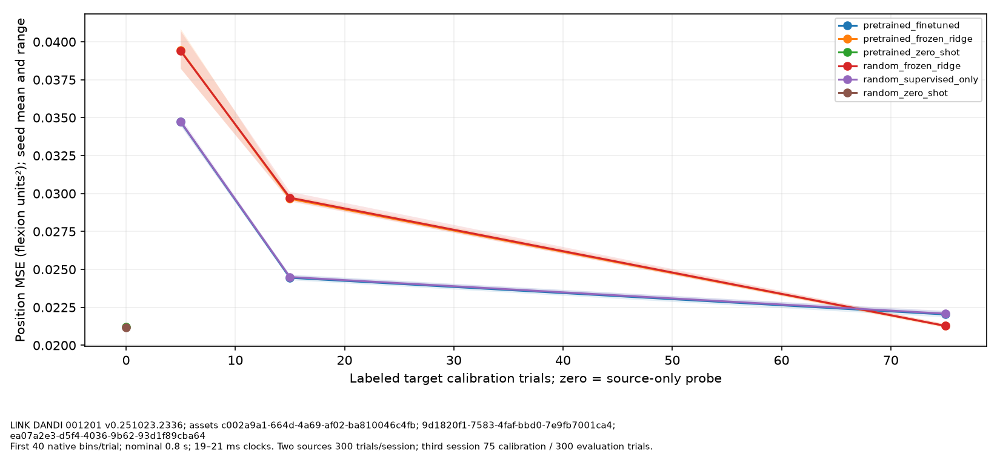
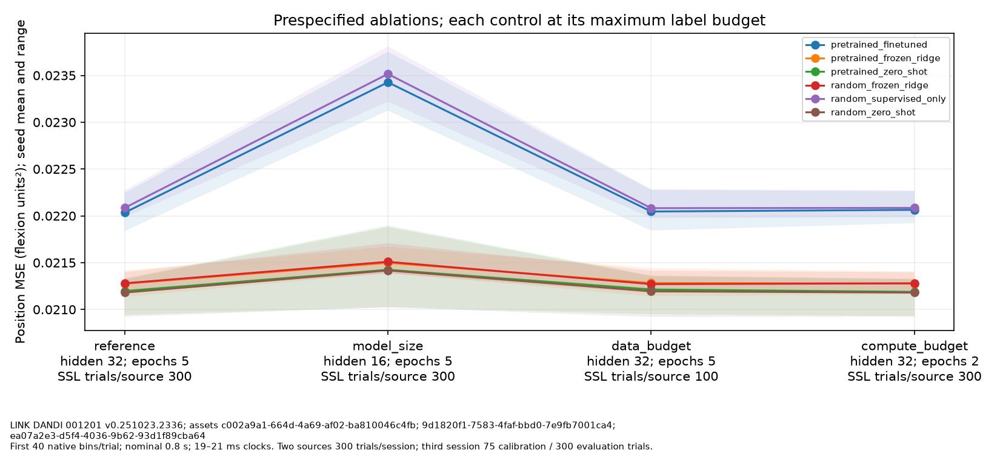
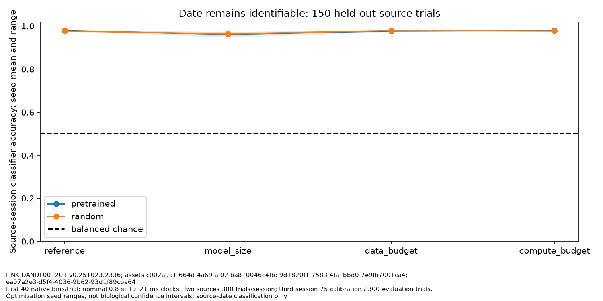

# Representation transfer experiment 09

LINK DANDI 001201 v0.251023.2336; assets c002a9a1-664d-4a69-af02-ba810046c4fb; 9d1820f1-7583-4faf-bbd0-7e9fb7001ca4; ea07a2e3-d5f4-4036-9b62-93d1f89cba64

First 40 native bins/trial; nominal 0.8 s; 19–21 ms clocks. Two sources 300 trials/session; third session 75 calibration / 300 evaluation trials.

Seeds [0, 1, 2]; 168 control rows and 24 identity diagnostics. All prespecified results retained. Seed ranges measure optimization variation, not biological confidence intervals. Random and self-supervised frozen controls are near-identical in these runs; this does not demonstrate a learned transfer advantage. Source-date classification accuracy is 98.0% (reference pretrained seed mean) on 150 untouched source trials, so latent session invariance is unsupported. Three sessions of one Monkey N do not establish subject generalization or a foundation model.

| Reference control | Target labeled trials | Mean MSE (flexion units²) | Seed range |
|---|---:|---:|---|
| pretrained_finetuned | 5 | 0.03471627 | 0.03450904–0.03483552 |
| pretrained_finetuned | 15 | 0.02444909 | 0.02428537–0.02466037 |
| pretrained_finetuned | 75 | 0.02203377 | 0.02183721–0.02224518 |
| pretrained_frozen_ridge | 5 | 0.03942498 | 0.03823029–0.04085947 |
| pretrained_frozen_ridge | 15 | 0.02965539 | 0.02952909–0.0298905 |
| pretrained_frozen_ridge | 75 | 0.02127406 | 0.02113477–0.02141457 |
| pretrained_zero_shot | 0 | 0.02119685 | 0.02094092–0.02133303 |
| random_frozen_ridge | 5 | 0.03938482 | 0.03823968–0.04070738 |
| random_frozen_ridge | 15 | 0.02972683 | 0.02947578–0.03011061 |
| random_frozen_ridge | 75 | 0.02127916 | 0.02118684–0.0213979 |
| random_supervised_only | 5 | 0.03473951 | 0.03444293–0.03501 |
| random_supervised_only | 15 | 0.02449658 | 0.02439235–0.02462049 |
| random_supervised_only | 75 | 0.02208483 | 0.02198446–0.02227286 |
| random_zero_shot | 0 | 0.02118027 | 0.02092331–0.02132278 |

[Evaluation uncertainty and null controls](evaluation_11.md) are reported separately; these plots do not select a best test configuration.

Attribution: Temmar, Hisham; Gill, Nina; Wang, Yixuan; and LINK contributors, CC-BY-4.0; [pinned release](https://dandiarchive.org/dandiset/001201/0.251023.2336).

Limitations: Observed same-subject, three-session experiment; not validated foundation-model capability; Contact coordinates establish feature order, not longitudinal neuron identity; Fixed first40 native samples restrict observations to 0.8 seconds per trial and may truncate task events; Current native neural bin predicts same-time native position offline; no closed-loop validation; Source nominal 20 ms count bins have native timestamp-step jitter; original clocks are preserved and deviations beyond the configured tolerance are rejected; GRU recurrence advances by native sample order, not continuously by physical clock intervals; temporal dynamics are not exact continuous-time models; One-factor settings are finite ablations, not scaling laws or optimized convergence; Initialization seeds do not provide independent subject/session replication; The data100 setting changes both SSL observations and the scaler-fitting pool while labeled source probes remain300/session; it is not an isolated SSL-objective data effect; No subject/session/time identifiers are supplied as model inputs; above-chance identity probing nevertheless indicates retained source-date information, not identity-free representations; Session-classifier accuracy is an auxiliary diagnostic, not a significance test or independent-subject inference

